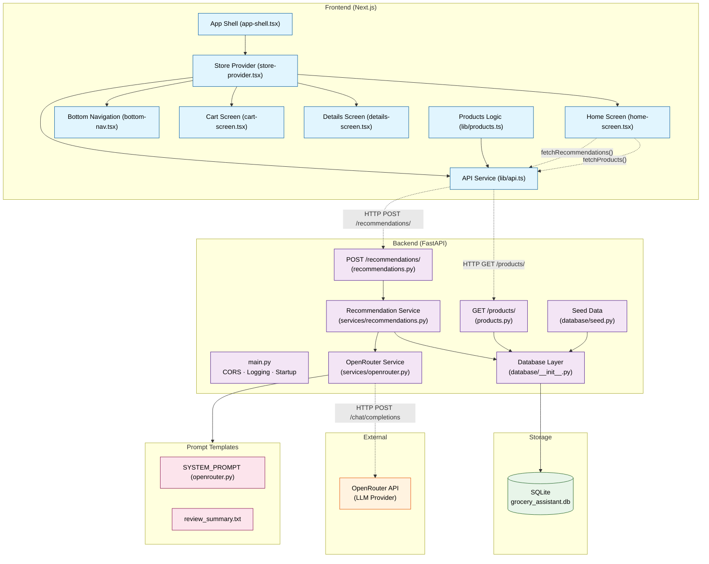

# Architecture Diagram

## Request Lifecycle

### Products Request
1. User opens the app → `AppShell` renders → `StoreProvider` mounts
2. `useEffect` calls `fetchProducts()` → `lib/api.ts` sends `GET /products/`
3. FastAPI route handler queries all products + review counts via SQLAlchemy
4. Returns JSON array → mapped to frontend `Product` type via `mapApiProduct()`
5. Products displayed in `HomeScreen` grid, filtered by search/category

### Recommendations Request
1. User adds items to cart → `useEffect` triggers after 500ms debounce
2. `fetchRecommendations(cartNames)` → `POST /recommendations/` with `{ cart: [...] }`
3. Backend routes to `services/recommendations.py`:
   - Matches cart items against `RECOMMENDATION_RULES` dictionary
   - Finds matching products via SQL LIKE query
   - Optionally calls OpenRouter for LLM-generated explanations
   - Falls back to rule-based reasons if LLM unavailable
4. Returns up to 3 recommendations → displayed as "AI Picks" cards

### LLM Explanation Flow
1. `RecommendationService._build_llm_explanation()` fetches reviews for the product
2. Calls `OpenRouterService.explain_recommendation()` with cart, product details, reviews
3. System prompt (hardcoded) + user prompt (dynamic) sent to OpenRouter API
4. Response parsed and validated against Pydantic `RecommendationExplanation` model
5. JSON repair (code fences, extraction) attempted on malformed responses
6. Returns structured explanation or `None` → caller uses fallback reason